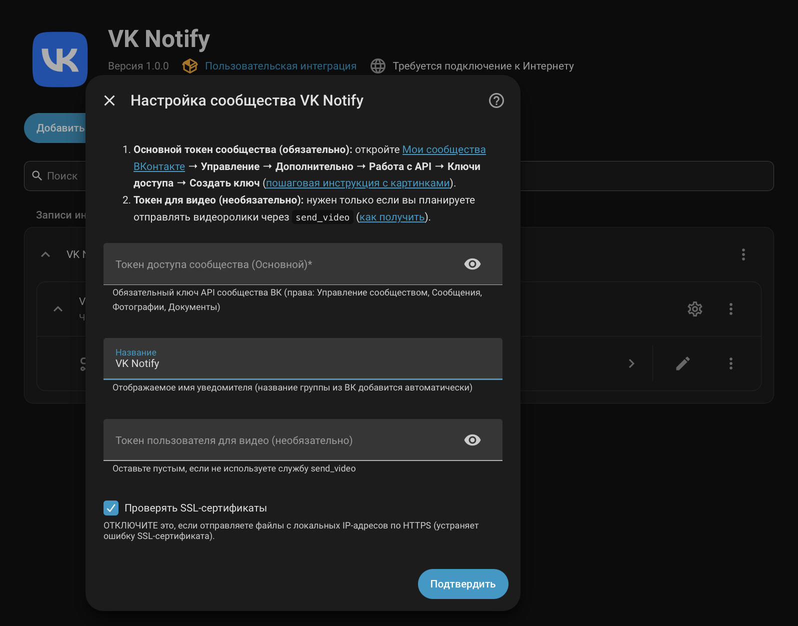
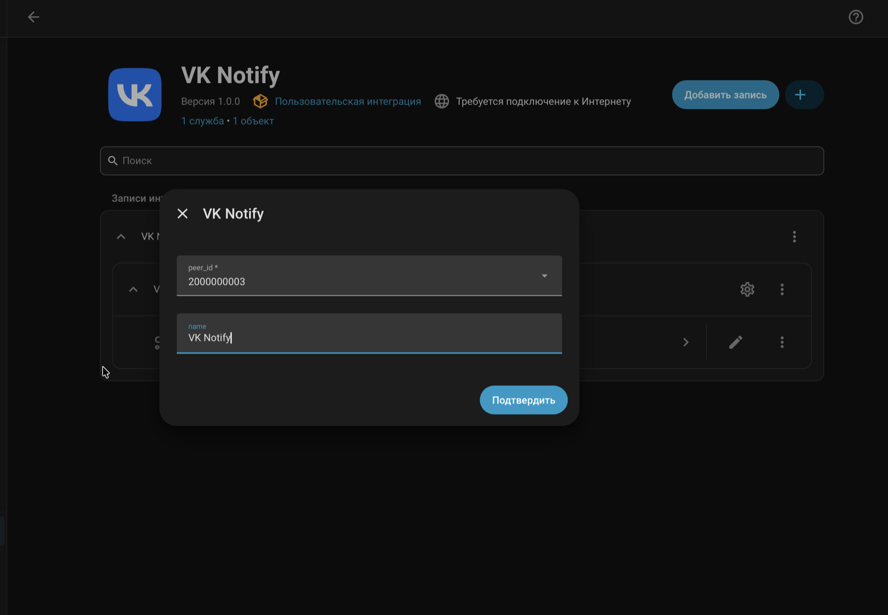
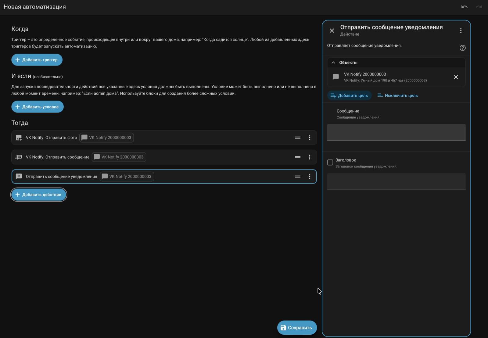
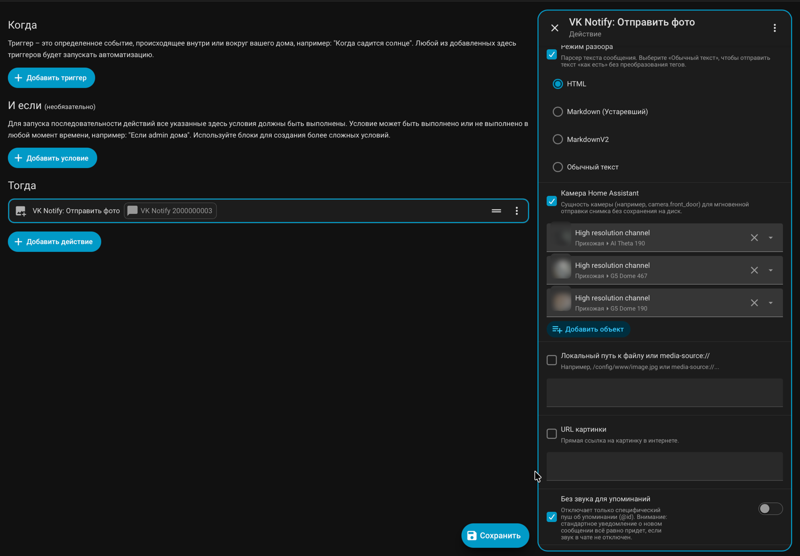
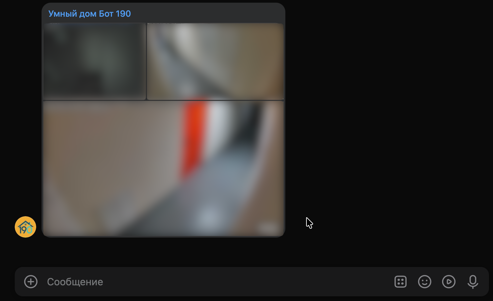

  

<h1 align="center">VK Notify Integration for Home Assistant</h1>

  
  
  
  
  
  

  <a href="README.md">🇷🇺 Русский</a> | <b>🇬🇧 English</b>

**VK Notify** custom integration for **Home Assistant** — send text notifications, photos (directly from Home Assistant `camera.*` entities, **Frigate** event URLs, or local files, including multi-photo albums of up to 10 attachments), documents, voice messages, native VK videos, interactive keyboards, and carousels, as well as receive incoming commands, attachments, voice message transcripts (`transcript`), and inline button callbacks via **VK API (v5.199)** and **Bots Long Poll API**. Compatible with **Home Assistant 2025.8+ and 2026.x**.

---

## ✨ Key Features

* 🧩 **"Community (Bot) → Chats" Hierarchy (`ConfigSubentry`, HA 2026 Standard):** Add your VK community bot **once** with its token, and connect any number of group chats or direct dialogs in a single click using the **"Add chat"** button on the community card — without ever re-entering the token! You can also select multiple chats at once during initial setup.
* 📷 **Direct Multi-Camera Snapshot Capture (`camera_entity` in `send_photo`) & Albums (Up to 10 Attachments):** Pass one or multiple Home Assistant camera entities (`camera.front_door`, `camera.backyard`), `url` links, or `file` paths. Frames are captured directly in RAM via `camera.async_get_image` (Zero-Disk I/O) and delivered as a single VK photo album without writing temporary files to `/config/www/`.
* 🗂 **`media-source://` & Remote File URL Support:** All media services (`send_photo`, `send_file`, `send_video`, `send_voice`) accept `media-source://...` URIs, while `send_file` and `wall_post` also download documents directly via `url`.
* 🔑 **Stored `video_access_token` in Integration Settings:** Optionally store your VK User Token once in the integration configuration (or via **Reconfigure**, alongside switching `API ↔ Long Poll` mode) instead of exposing it in YAML automations.
* 🎙 **Incoming Attachments & Voice Transcripts (`transcript`) in Long Poll:** `vk_notify_text` and `vk_notify_command` events expose an `attachments` list (highest-resolution photo URLs, documents, voice messages `link_ogg`/`link_mp3`), `geo` coordinates, and VK's speech-to-text recognition in `transcript`.
* 🖼 **Magic-Bytes MIME Detection & Automatic WebP/BMP Normalization:** Detects image formats (`JPEG`, `PNG`, `GIF`, `WebP`, `BMP`) from magic bytes and HTTP headers, recovers truncated RTSP frames (`LOAD_TRUNCATED_IMAGES`), resizes >2560 px frames with `LANCZOS`, and re-encodes to baseline RGB JPEG in memory via `Pillow`.
* 🛡 **`HTTP 405` Redirect Protection, Automatic Rate-Limit Retries (`Error 6/9/10`), and Secret Redaction (`diagnostics.py`):** Unified `VkApiClient` with exponential backoff, protection against `POST -> GET` upload redirects, and automatic token/password/hash redaction in logs and diagnostic downloads.

---

## 🔑 Step 1. Creating a VK Community & Obtaining the Community Access Token

Only **one required key** is needed — the **VK Community Access Token** (used for all text notifications, camera snapshots, photos, documents, voice messages, keyboards, and Long Poll events):

1. Open **[My VK Communities (vk.com/groups?tab=admin)](https://vk.com/groups?tab=admin)** and create a new private community (or open an existing one).
2. Navigate to **Manage → Additional → API usage → Access tokens** and click **"Create token"** with permissions:
   - ✅ **Manage community** — required to auto-detect `group_id`, community name, and use **Long Poll**;
   - ✅ **Community messages** — required to send and edit notifications;
   - ✅ **Community photos** — required for `vk_notify.send_photo`;
   - ✅ **Community documents** — required for `vk_notify.send_file` and `vk_notify.send_voice`.
3. Under **Manage → Messages**, set **Community messages: Enabled**, and under **Bot settings**, set **Bot capabilities: Enabled**.
4. For two-way communication (incoming commands and inline button callbacks), go to **API usage → Long Poll API**, enable **Long Poll API** (`API Version: 5.199`), and enable **Event types**: *Incoming message* (`message_new`) and *Message event / callback* (`message_event`).
5. **Send a first message** to the community from your VK account (or create a group chat under **Manage → Chats**).

👉 **[Detailed Step-by-Step Illustrated Setup Guide (docs/SETUP_GUIDE.md)](docs/SETUP_GUIDE.md)**

> 💡 **What is the "User Token for Video" (`video_access_token`)?**
> It is **completely optional**. VK API rules prohibit community bots from uploading native video player clips (`video.save`). If you do not use `vk_notify.send_video`, simply leave this field empty! See [docs/VIDEO_TOKEN_GUIDE.md](docs/VIDEO_TOKEN_GUIDE.md) if you need native video uploads.

---

## 📦 Step 2. Installation & Setup in Home Assistant

### Option 1: Via HACS / Marketplace (HA 2026.11+)

Alternatively, add `https://github.com/Eugen417/ha_vk_notify_plus` as a custom repository in HACS / Marketplace (category: **Integration**), install **VK Notify**, and restart Home Assistant.

### Option 2: Manual Installation

1. Copy `custom_components/vk_notify/` into your Home Assistant `config/custom_components/` directory.
2. Restart Home Assistant.

### Connecting a Community & Selecting Chats

1. Go to **Settings → Devices & Services → Add Integration** and search for **VK Notify**.
2. Paste your **Community Access Token (Main)** and click **Submit** (the VK community name is fetched automatically):

  

3. Select the connection mode: **API** (send only) or **Long Poll** (send + receive incoming messages and button callbacks).
4. Select **one or multiple chats** — each selected chat creates a `ConfigSubentry` and its own `notify.vk_notify_<peer_id>` entity.

### ➕ Adding Another Chat to the Same Community (Without Re-Entering the Token)

1. Open **Settings → Devices & Services → VK Notify**.
2. On the community card, click **"Add chat"** (or the **⚙️** icon next to an existing chat):

  

3. Pick a conversation from the dropdown (or enter a numeric `peer_id` manually) and click **Submit**.

---

## 🛠 Available Services

All services are registered under the `vk_notify` domain:

* **`vk_notify.send_message`** — Primary notification service. Sends formatted text, geo-coordinates, VK attachment IDs, inline/reply keyboards, or interactive carousels (`template`), returning `message_id` and `conversation_message_id` via `response_variable`.
* **`vk_notify.send_photo`** — Sends one or up to 10 photos as an album (`JPEG`, `PNG`, `GIF`, `WebP`, `BMP`). Supports Home Assistant camera entities (`camera_entity`), remote URLs (`url`, including **Frigate** snapshots), `media-source://`, and local files (`/config/www/`).
* **`vk_notify.send_file`** — Uploads and sends documents from a local `file`, `media-source://`, or `url`.
* **`vk_notify.send_video`** — Uploads and sends video clips (e.g., `.mp4`) as native VK player videos via local `file`, `media-source://`, or `url` (uses stored or per-call `video_access_token`).
* **`vk_notify.send_voice`** — Sends `.ogg` audio files as native VK voice messages.
* **`vk_notify.edit_message`** — Edits text, keyboard, or attachments of a previously sent message.
* **`vk_notify.delete_message`** — Deletes a message (`delete_for_all: true` by default).
* **`vk_notify.answer_callback`** — Stops the loading spinner on inline callback buttons and optionally displays a snackbar toast (up to 90 characters).
* **`vk_notify.set_activity`** — Displays bot typing/recording status (`typing` or `audiomsg`).
* **`vk_notify.send_reaction`** — Sets an emoji reaction on a message by `conversation_message_id`.
* **`vk_notify.pin_message`** / **`vk_notify.unpin_message`** — Pins or unpins a chat message.
* **`vk_notify.get_user_info`** — Queries user profile info (first name, last name, online status) by VK ID and returns it via `response_variable`.
* **`vk_notify.send_sticker`** — Sends a VK sticker by numeric `sticker_id`.
* **`vk_notify.edit_chat`** — Renames a group chat (bot must be chat admin).
* **`vk_notify.wall_post`** — Publishes a post to the community wall.

### 💡 `vk_notify.send_message` vs. Core `notify.send_message`

  

| Capability | `vk_notify.send_message` | `notify.send_message` |
| :--- | :---: | :---: |
| **Intended Use** | **Primary action for all VK automations** | Compatibility with generic Blueprints & core `Alert` |
| **Text (`message`) & Title (`title`)** | ✅ Yes | ✅ Yes (only fields permitted by HA core) |
| **Keyboards (`keyboard`, `inline_keyboard`) & Carousels (`template`)** | ✅ Yes | ❌ No |
| **Geolocation (`lat`, `long`), Attachments (`attachment`), Reply (`reply_to`)** | ✅ Yes | ❌ No |
| **Markup Mode (`parse_mode`: `html`, `markdownv2`, `plain`)** | ✅ Yes | ❌ Always default `html` |
| **Returns Sent Message IDs (`response_variable`)** | ✅ Returns `message_id` & `conversation_message_id` | ❌ No response data |

---

## 🤖 Automation Examples

Ready-to-use YAML examples — from simple text alerts to interactive control panels, carousels, geolocation, and self-deleting alerts:

👉 **[Browse All Automation Examples (docs/AUTOMATIONS.md)](docs/AUTOMATIONS.md)** | 📖 **[VK Community Setup Guide (docs/SETUP_GUIDE.md)](docs/SETUP_GUIDE.md)**

---

## 📷 Photo & Multi-Camera Album Pipeline (`vk_notify.send_photo`)

When sending snapshots from `camera_entity`, **Frigate** `url` links, or local `file` paths, each frame is normalized in an executor thread pool so VK upload servers (`pu.vk.com`) accept it reliably on the first attempt:

1. **Zero-Disk I/O RAM Capture:** Captures `camera.*` frames directly in memory via `camera.async_get_image` (with up to 3 automatic retries if an RTSP stream wakes up slowly) without writing temporary files to disk.
2. **Magic-Bytes Format Detection:** Identifies `JPEG`, `PNG`, `GIF`, `WebP`, and `BMP` by file header bytes and HTTP headers (works seamlessly with extensionless URLs like `/api/events/.../thumbnail`).
3. **Truncated Frame Recovery (`LOAD_TRUNCATED_IMAGES`):** Automatically repairs RTSP/NVR JPEG frames missing an `EOI` marker via `Pillow`.
4. **Smart `2560 px` `LANCZOS` Resize & `baseline RGB JPEG` Encoding:** Preserves EXIF orientation, normalizes extreme aspect ratios (`1:20` VK limit), and converts `WebP`/`BMP`/high-res 4K/360° frames to `baseline RGB JPEG` (`quality=90`).
5. **Multi-Camera Albums (Up to 10 Attachments):** Uploads multiple camera snapshots with a `0.35 s` rate-limit guard and sends them as a single VK album grid (fault-tolerant if one camera is offline).

  

  

---

## 🔤 Text Formatting (`parse_mode`)

* **`html`** *(Default)* — `<b>bold</b>`, `<i>italic</i>`, `<u>underline</u>`, `<a href="https://www.home-assistant.io">link</a>`, ` `.
* **`markdownv2`** — `**bold**`, `*italic*`, `__underline__`, `[link](https://www.home-assistant.io)`.
* **`markdown`** *(Legacy)* — basic Markdown for backward compatibility.
* **`plain`** — sends raw text verbatim without tag parsing (ideal for logs or code snippets).
* Supports VK mentions (`@id123456`, `[id123456|Name]`) and silent mentions (`disable_mentions: true`).

---

## 📡 Long Poll Mode — Incoming Events

When **Long Poll** mode is enabled, the integration fires real-time events on the Home Assistant event bus for configured chats:

1. **`vk_notify_command`** (messages starting with `/`): `command`, `text`, `peer_id`, `from_id`, `conversation_message_id`, `entity_id`.
2. **`vk_notify_callback`** (inline `callback` button clicks): `payload`, `event_id`, `user_id`, `peer_id`, `conversation_message_id`, `entity_id`.
3. **`vk_notify_text`** (regular messages, media, voice messages): `text`, `peer_id`, `from_id`, `conversation_message_id`, `entity_id`, `attachments`, `transcript` (VK speech-to-text transcript for voice messages), `geo` (`latitude`, `longitude`).
4. **`vk_notify_typing`** & **`vk_notify_read`** (direct community dialogs): `user_id`, `peer_id`, `state` / `read_message_id`.

### ⏱ Configurable Connection Timeout
`vk_notify.send_message`, `send_photo`, `send_file`, `send_video`, and `send_voice` support a `timeout` parameter in seconds (default: `60`, range: `5`–`600`).

---

## 📄 License

This project is distributed under the **MIT License**. See [LICENSE](LICENSE) for details.

