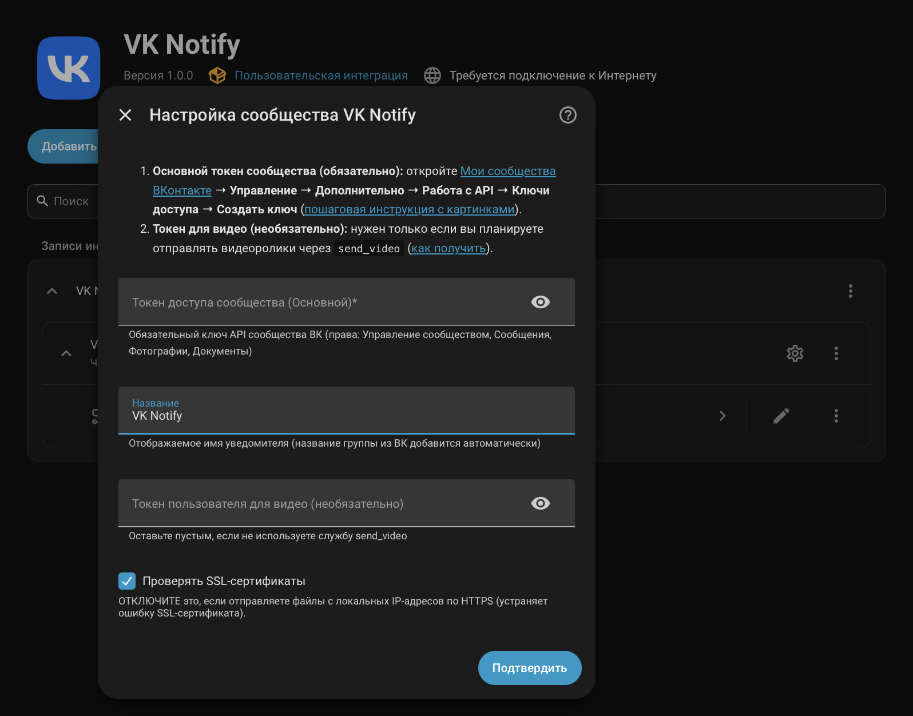
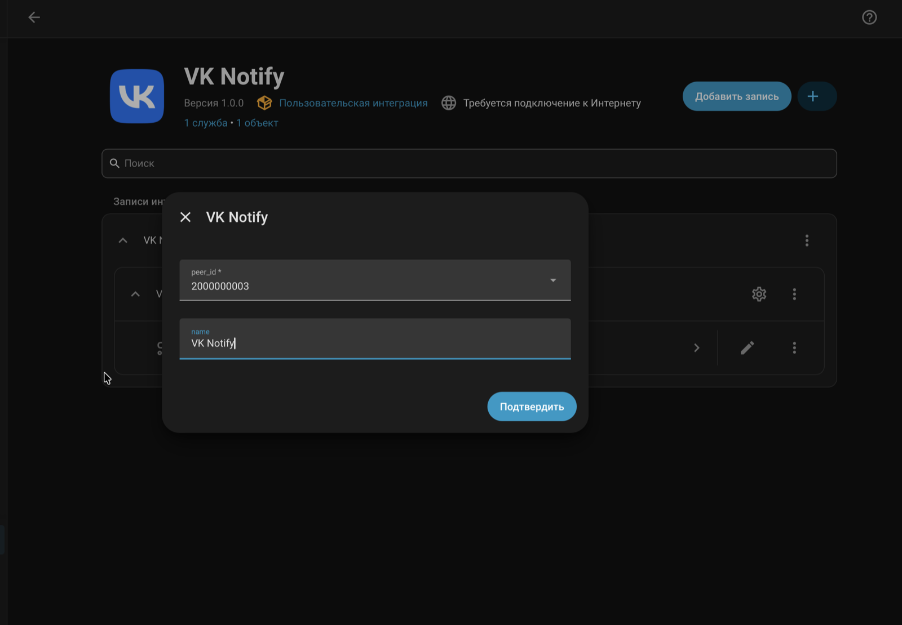
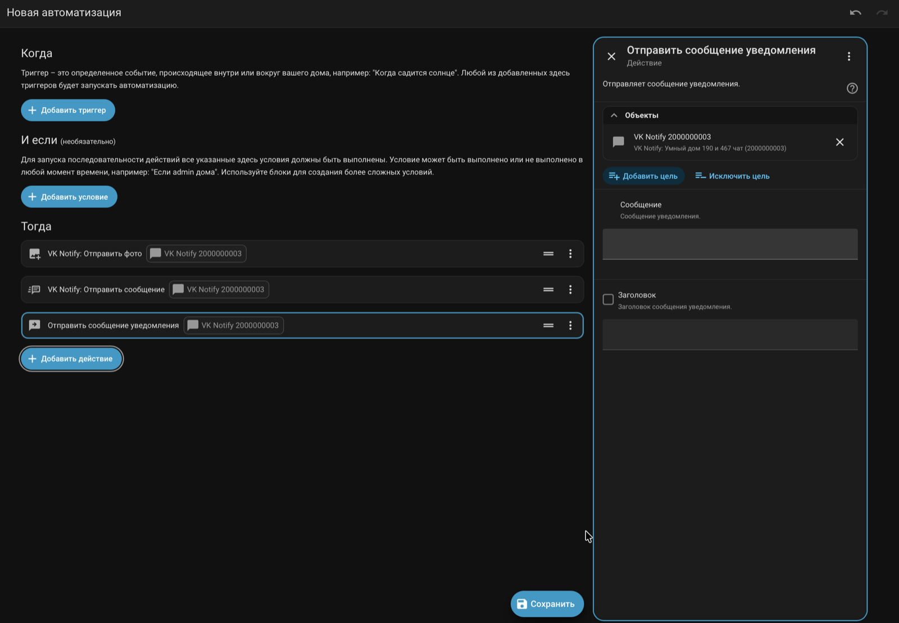
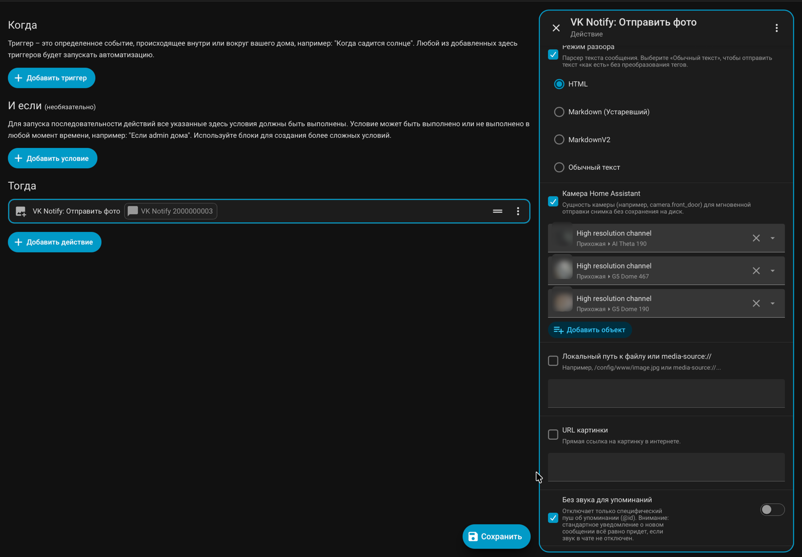
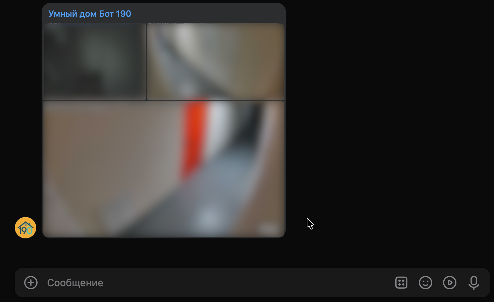

  

<h1 align="center">VK Notify Integration for Home Assistant</h1>

  
  
  
  
  
  

Интеграция **VK Notify** для **Home Assistant** — отправка текстовых уведомлений, фотографий (напрямую с камер Home Assistant `camera.*`, снимков **Frigate** по URL или из локальных файлов, включая альбомы до 10 вложений), документов, голосовых и нативных видеосообщений, интерактивных клавиатур, каруселей и приём входящих команд, голосовых сообщений (`transcript`) и нажатий кнопок через **VK API (v5.199)** и **Bots Long Poll API**. Полностью совместима с **Home Assistant 2026.11+**.

---

## ✨ Главные возможности версии 1.0.0

* 🧩 **Иерархия «Сообщество (Бот) → Чаты» (`ConfigSubentry`, стандарт HA 2026):** Вы добавляете сообщество (бота ВК) **один раз** со своим токеном, а внутри карточки этого сообщества в 1 клик кнопкой **«Добавить чат»** подключаете любое количество бесед и личных диалогов без повторного ввода токена! При первичной настройке также можно отметить галочками сразу несколько чатов.
* 📷 **Прямая отправка снимков с одной или нескольких камер (`camera_entity` в `send_photo`) и альбомов (до 10 вложений):** Передайте одну или список сущностей камер Home Assistant (`camera.front_door`, `camera.backyard`), список `url` или `file`, и интеграция мгновенно снимет кадры в памяти через `camera.async_get_image` и отправит их одним сообщением-альбомом без сохранения временных файлов в `/config/www/`.
* 🗂 **Поддержка `media-source://` и URL для файлов:** Во всех медиа-службах (`send_photo`, `send_file`, `send_video`, `send_voice`) поддерживаются URI `media-source://...`, а `send_file` и `wall_post` умеют скачивать документы напрямую по `url`.
* 🔑 **Сохранение `video_access_token` в настройках интеграции:** Пользовательский токен для `send_video` и `wall_post` можно один раз указать в настройках интеграции (или при перенастройке `Перенастроить` вместе с переключением режима `API ↔ Long Poll`), не дублируя его в открытом виде в YAML каждой автоматизации.
* 🎙 **Входящие вложения и расшифровка голосовых (`transcript`) в Long Poll:** События `vk_notify_text` и `vk_notify_command` передают массив `attachments` (фото максимального разрешения, документы, голосовые сообщения `link_ogg`/`link_mp3`), геокоординаты `geo` и готовый текст распознавания голоса от ВК в поле `transcript`.
* 🖼 **Автоматическое определение MIME-типа и конвертация WebP/BMP:** Определение реального формата изображения (`JPEG`, `PNG`, `GIF`, `WebP`, `BMP`) по сигнатуре байтов (**magic bytes**), заголовкам `Content-Type` / `Content-Disposition` и автоматическая конвертация `WebP`/`BMP` в `JPEG`/`PNG` в памяти через `Pillow`.
* 🛡 **Защита от `HTTP 405`, авто-повтор при лимитах ВК (`Error 6/9/10`) и маскирование секретов (`diagnostics.py`):** Единый клиент `VkApiClient` с экспоненциальным ретраем, защита от редиректов `POST -> GET` на серверах выгрузки ВК и автоматическое удаление токенов/паролей/хэшей из логов и диагностических файлов.
* 🎨 **Модульная архитектура и нативные иконки (HA 2026.11+):** Разделение кода на профильные модули (`api.py`, `media.py`, `formatting.py`, `services.py`, `longpoll.py`, `diagnostics.py`), привязка к сервисному устройству `DeviceInfo(SERVICE)`, комплект иконок `brand/` и `icons.json`.

---

## 🔑 Шаг 1. Создание сообщества ВКонтакте и получение Токена Сообщества (Основной ключ)

Для работы интеграции нужен **один обязательный ключ** — **Токен доступа сообщества ВКонтакте** (именно через него отправляются все текстовые уведомления, снимки камер, фотографии, документы, голосовые сообщения, кнопки и работает Long Poll):

1. Перейдите в раздел **[Мои сообщества ВКонтакте (vk.com/groups?tab=admin)](https://vk.com/groups?tab=admin)** и создайте новую закрытую группу (или откройте существующую).
2. В правом меню сообщества откройте **Управление → Дополнительно → Работа с API → Ключи доступа** и нажмите **«Создать ключ»**:
   - ✅ **Доступ к управлению сообществом** — для автоопределения `group_id`, имени группы и работы режима **Long Poll**;
   - ✅ **Доступ к сообщениям сообщества** — обязательно для отправки и редактирования уведомлений;
   - ✅ **Доступ к фотографиям сообщества** — для отправки фото и снимков с камер (`vk_notify.send_photo`);
   - ✅ **Доступ к документам сообщества** — для отправки файлов и голосовых сообщений (`vk_notify.send_file`, `vk_notify.send_voice`).
3. В меню **Управление → Сообщения** включите **Сообщения сообщества: Включены**, а в подразделе **Настройки для бота** включите **Возможности ботов: Включены**.
4. Для двусторонней связи (команды и нажатия кнопок) в разделе **Работа с API → Long Poll API** включите Long Poll (`Версия API: 5.199`) и отметьте на вкладке **Типы событий**: *«Входящее сообщение»* и *«Действие с сообщением»*.
5. **Напишите боту первое сообщение** со своего аккаунта ВК (или создайте беседу в разделе **Управление → Чаты**).

👉 **[Подробная пошаговая инструкция со скриншотами каждого шага (docs/SETUP_GUIDE.md)](docs/SETUP_GUIDE.md)**

> 💡 **А что такое «Токен пользователя для видео» (`video_access_token`)?**
> Это **полностью необязательный** дополнительный ключ. По правилам VK API ботам сообществ запрещено загружать видеоролики в нативный видеоплеер ВК (`video.save`). Поэтому, если вы **не используете** службу `vk_notify.send_video`, просто оставьте поле `Токен пользователя для видео` пустым! Если же отправка видео нужна — см. [отдельную инструкцию по получению видео-токена](docs/VIDEO_TOKEN_GUIDE.md).

---

## 📦 Шаг 2. Установка и настройка в Home Assistant

### Установка через HACS / Marketplace (HA 2026.11+)

Если кнопка не работает: добавьте пользовательский репозиторий `https://github.com/Eugen417/ha_vk_notify_plus` в HACS / Marketplace вручную (категория: **Интеграция**), установите **VK Notify** и перезапустите Home Assistant.

### Установка вручную (без HACS)

1. Скопируйте папку `custom_components/vk_notify/` в директорию `config/custom_components/` вашего Home Assistant.
2. Перезапустите Home Assistant.

### Подключение сообщества и добавление чатов

1. Перейдите в **Настройки → Устройства и службы → Добавить интеграцию** и найдите **VK Notify**.
2. Вставьте **Токен доступа сообщества (Основной)** и нажмите **Подтвердить** (название группы из ВК подтянется автоматически):

  

3. Выберите режим подключения: **API** (только отправка) или **Long Poll** (отправка + получение входящих сообщений и нажатий кнопок).
4. Отметьте **один или сразу несколько чатов** из списка — для каждого выбранного чата будет создан вложенный объект (`ConfigSubentry`) и своя сущность `notify.vk_notify_<peer_id>`.

### ➕ Как добавить ещё один чат в то же сообщество (без ввода токена)

Вам **не нужно** заново добавлять интеграцию и копировать токен:
1. Откройте **Настройки → Устройства и службы → VK Notify**.
2. На карточке нужного сообщества нажмите кнопку **«Добавить чат»** (*Add chat*) или значок **⚙️** напротив существующего чата:

  

3. Выберите беседу из выпадающего списка диалогов сообщества (или введите `peer_id` вручную) и нажмите **Подтвердить**.

---

## 🛠 Доступные службы (Services)

Интеграция предоставляет богатый набор служб для управления сообщениями, реакциями и чатами. Все они вызываются через домен `vk_notify`:

* **`vk_notify.send_message`** — Базовая служба. Отправляет текстовое уведомление, координаты, медиа-вложения (по готовому ID) или интерактивную карусель (шаблон).
* **`vk_notify.send_photo`** — Отправляет фотографию (`JPEG`, `PNG`, `GIF`, `WebP`, `BMP`). Поддерживает прямую отправку снимка с камеры Home Assistant (`camera_entity`), загрузку по прямой ссылке (`url`, включая снимки **Frigate**), `media-source://` и локальные файлы (`/config/www/`).
* **`vk_notify.send_file`** — Загружает и отправляет произвольный документ по локальному пути (`file`), `media-source://` или прямой ссылке (`url`).
* **`vk_notify.send_video`** — Загружает и отправляет видеофайл (например, `.mp4`) как нативное видео с полноценным плеером ВКонтакте. Поддерживает локальные пути, `media-source://` и прямые ссылки (`url`). Токен пользователя (`video_access_token`) можно сохранить один раз в настройках интеграции или передать в вызове службы ([инструкция по получению токена](docs/VIDEO_TOKEN_GUIDE.md)).
* **`vk_notify.send_voice`** — Отправляет аудиофайл (строго в формате `.ogg`) как нативное голосовое сообщение.
* **`vk_notify.edit_message`** — Изменяет текст, клавиатуру и вложения ранее отправленного сообщения.
* **`vk_notify.delete_message`** — Удаляет сообщение у всех участников чата.
* **`vk_notify.answer_callback`** — Служба для работы с кнопками (Снэкбары). Останавливает кружок загрузки на нажатой кнопке и опционально показывает всплывающее уведомление (до 90 символов).
* **`vk_notify.set_activity`** — Показывает статус активности бота: «печатает текст...» (`typing`) или «записывает голосовое сообщение...» (`audiomsg`).
* **`vk_notify.send_reaction`** — Устанавливает эмодзи-реакцию (лайк, огонь и т.д.) на конкретное сообщение по его ID.
* **`vk_notify.pin_message`** — Закрепляет выбранное сообщение в шапке беседы.
* **`vk_notify.unpin_message`** — Открепляет выбранное сообщение (или последнее закрепленное, если ID не передан).
* **`vk_notify.get_user_info`** — Запрашивает данные профиля (Имя, Фамилия, статус Онлайн, время последнего визита) по VK ID. Возвращает данные через локальную переменную (`response_variable`).
* **`vk_notify.send_sticker`** — Отправляет стандартный стикер ВКонтакте по его числовому идентификатору.
* **`vk_notify.edit_chat`** — Меняет название групповой беседы (внимание: для этого бот должен быть назначен администратором беседы).
* **`vk_notify.wall_post`** — Отправляет новую запись на публичную стену вашего сообщества.

### 💡 В чём разница между `vk_notify.send_message` и стандартным `notify.send_message`?

При создании автоматизации в визуальном редакторе Home Assistant вы увидите два похожих действия для отправки текста:
1. **«VK Notify: Отправить сообщение» (`vk_notify.send_message`)** — фирменная расширенная служба интеграции.
2. **«Отправить сообщение уведомления» (`notify.send_message`)** — стандартное системное действие ядра Home Assistant.

  

Почему их две и какую выбирать:

| Возможность | `vk_notify.send_message` *(VK Notify: Отправить сообщение)* | `notify.send_message` *(Отправить сообщение уведомления)* |
| :--- | :---: | :---: |
| **Назначение** | **Основная служба для всех автоматизаций ВК** | Совместимость со сторонними универсальными Blueprint'ами и компонентами HA (`Alert` и др.) |
| **Текст (`message`) и Заголовок (`title`)** | ✅ Да | ✅ Да (только эти 2 поля разрешены ядром HA) |
| **Интерактивные кнопки (`keyboard`, `inline_keyboard`)** | ✅ Да | ❌ Нет |
| **Карусель карточек (`template`)** | ✅ Да | ❌ Нет |
| **Геолокация на карте (`lat`, `long`)** | ✅ Да | ❌ Нет |
| **Готовые медиа из ВК по ID (`attachment`)** | ✅ Да (`photo123_456`, `doc...`) | ❌ Нет |
| **Ответ (цитата) на сообщение (`reply_to`)** | ✅ Да | ❌ Нет |
| **Выбор режима разметки (`parse_mode`)** | ✅ Да (`HTML`, `MarkdownV2`, `plain`) | ❌ Всегда `HTML` по умолчанию |
| **Возврат ID отправленного сообщения (`response_variable`)** | ✅ Возвращает `message_id` и `conversation_message_id` (для последующего закрепа, редактирования или удаления) | ❌ Не возвращает ответ |

> **Рекомендация:** Во всех собственных сценариях и автоматизациях используйте именно **«VK Notify: Отправить сообщение» (`vk_notify.send_message`)**. Системная служба `notify.send_message` оставлена специально для того, чтобы уведомитель `notify.vk_notify_...` работал в готовых универсальных шаблонах Home Assistant, которые не знают о специфичных параметрах ВКонтакте.

---

## 🤖 Примеры автоматизаций

Мы собрали коллекцию готовых примеров: от простых текстовых ответов до сложных умных пультов с кнопками, каруселями, геолокацией и самоуничтожающимися сообщениями.

👉 **[Посмотреть все примеры автоматизаций (docs/AUTOMATIONS.md)](docs/AUTOMATIONS.md)** | 📖 **[Руководство по настройке ВК (docs/SETUP_GUIDE.md)](docs/SETUP_GUIDE.md)**

---

## 📷 Как работает обработка фотографий и мульти-камерных альбомов (`vk_notify.send_photo`)

При отправке снимков с камер видеонаблюдения (`camera_entity`), из **Frigate** по `url` или из локальных файлов (`file`) интеграция выполняет автоматическую подготовку каждого кадра в фоновом пуле потоков (`executor`), чтобы сервер загрузки ВКонтакте (`pu.vk.com`) гарантированно принял изображение с первого раза:

1. **Прямой захват в оперативной памяти (Zero-Disk I/O):**
   При выборе одной или нескольких сущностей `camera.*` кадры запрашиваются напрямую через `camera.async_get_image` в оперативной памяти без создания временных файлов на SSD/SD-карте. Если поток камеры спал и с первой попытки отдал пустой буфер, выполняется до 3 повторных запросов с паузой.
2. **Определение реального формата по сигнатуре байтов (Magic Bytes):**
   Формат (`JPEG`, `PNG`, `GIF`, `WebP`, `BMP`) определяется по первым байтам файла и заголовкам `Content-Type` / `Content-Disposition`, поэтому ссылки без расширения `.jpg` (например, `/api/events/.../thumbnail` во Frigate) работают корректно.
3. **Восстановление неполных RTSP/камерных кадров (`LOAD_TRUNCATED_IMAGES`):**
   При захвате видеопотока на лету камеры и регистраторы иногда отдают JPEG без финального маркера конца файла (`EOI`), из-за чего сервер ВК возвращает пустое поле `photo: ""`. Интеграция автоматически восстанавливает такие кадры через `Pillow` и дописывает корректные заголовки.
4. **Умный ресайзинг до `2560 px` и перекодирование в `baseline RGB JPEG`:**
   - ВКонтакте хранит фотографии в сообщениях максимум в разрешении **2560 px** по длинной стороне (размер `w` в VK API), а тяжёлые 4K/8MP и панорамные 360°-кадры (например, с камер *UniFi Protect AI Theta* или *G5 Dome High Resolution*) часто отклоняются сервером загрузки ВК.
   - Если длинная сторона снимка превышает **2560 px**, изображение пропорционально уменьшается алгоритмом `LANCZOS` до `2560 px` с сохранением ориентации `EXIF`.
   - Если соотношение сторон превышает лимит ВК `1:20`, кадр автоматически выравнивается.
   - Изображения `WebP`, `BMP` и прогрессивные/нестандартные JPEG перекодируются в эталонный **`baseline RGB JPEG` (`quality=90`, `progressive=False`)**, что ускоряет отправку в 3–5 раз.
5. **Сборка альбома (до 10 камер / фото в одном сообщении):**
   При выборе нескольких камер в интерфейсе автоматизации все снимки поочерёдно загружаются на сервер ВК с защитной паузой `0.35 с` и прикрепляются к одному сообщению в виде единой сетки-альбома. Если одна из камер временно отключена, снимки с остальных камер всё равно будут отправлены.

  

  

## 🔤 Форматирование текста

Интеграция автоматически преобразует вашу разметку в нативный формат ВКонтакте. Режим парсера задается параметром `parse_mode` в вызове службы.

### Доступные режимы (`parse_mode`)

* **`html`** *(По умолчанию)* — обрабатывает стандартные HTML-теги.
* **`markdownv2`** — современная обработка Markdown разметки. Корректно работает со спецсимволами (`-`, `.`, `+` и др.).
* **`markdown`** *(Устаревший)* — базовая поддержка Markdown (оставлена для обратной совместимости старых автоматизаций).
* **`plain`** *(Без форматирования)* — отправляет текст строго "как есть". Любые теги HTML или Markdown будут проигнорированы и отправлены как обычные символы. Идеально подходит для пересылки системных логов или программного кода.

### Поддерживаемый синтаксис

| Результат | HTML (`parse_mode: html`) | Markdown (`parse_mode: markdownv2`) |
| :--- | :--- | :--- |
| **Жирный текст** | `<b>Текст</b>` или `<strong>Текст</strong>` | `**Текст**` |
| *Курсив* | `<i>Текст</i>` или `<em>Текст</em>` | `*Текст*` |
| <u>Подчеркнутый</u> | `<u>Текст</u>` | `__Текст__` |
| [Текст ссылки](https://ha.ru) | `<a href="https://ha.ru">Текст</a>` | `[Текст](https://ha.ru)` |
| Перенос строки | ` ` или обычный перенос `\n` | Обычный перенос `\n` |

### Особенности форматирования и упоминания

* **Заголовки:** ВКонтакте не поддерживает изменение размера шрифта (заголовки H1, H2) в личных сообщениях. Если вы используете решетки из Markdown (например, `# Заголовок`), интеграция автоматически удалит их для эстетичного вида. Для выделения заголовков используйте жирный шрифт и эмодзи.
* **Упоминания (Меншены):** Вы можете упоминать пользователей в тексте сообщения стандартными способами ВК: `@id123456`, `*id123456` или `[id123456|Имя пользователя]`. 
* **Тихие упоминания:** Если вы хотите упомянуть пользователя, но не отправлять ему отдельный пуш со звуком, передайте параметр `disable_mentions: true` вместе с сообщением.

## Режим Long Poll — получение сообщений

При включении Long Poll интеграция генерирует события в шине Home Assistant в реальном времени. События публикуются только для чатов, добавленных в интеграцию.

Для включения Long Poll необходимо:
1. Включить **Bots Long Poll API** в управлении сообществом: **Управление → Работа с API → Bots Long Poll API → Включён**.
2. Выбрать типы событий (обязательно: **Входящие сообщения**, опционально для доп. функций: **Входящие сообщения -> Действия с сообщениями**).

### Типы событий и их поля (Event Data)

#### 1. `vk_notify_command` — команды (сообщения, начинающиеся с `/`)
Идеально для запуска конкретных скриптов (например, `/start` или `/свет`).
| Поле | Описание |
| :--- | :--- |
| `command` | Имя команды без `/` (например, `свет`). Удобно использовать в шаблонах. |
| `text` | Полный оригинальный текст сообщения (включая саму команду). |
| `peer_id` | ID чата/беседы, из которого пришло сообщение. |
| `from_id` | ID пользователя-отправителя (полезно для `get_user_info`). |
| `conversation_message_id` | Внутренний ID сообщения (нужен для реплаев, закрепов и удаления). |
| `entity_id` | Служба (уведомитель) HA, связанная с этим чатом. |

#### 2. `vk_notify_callback` — нажатие интерактивных кнопок
Генерируется при нажатии пользователем на `inline`-кнопку типа `callback`.
| Поле | Описание |
| :--- | :--- |
| `payload` | Скрытые данные кнопки (JSON-объект). Например: `{"action": "turn_on"}`. |
| `event_id` | Временный ID события нажатия. Обязателен для вызова `answer_callback` (Снэкбаров). |
| `user_id` | ID пользователя, который нажал кнопку. |
| `peer_id` | ID чата, в котором находится кнопка. |
| `conversation_message_id` | ID сообщения с клавиатурой (нужно, чтобы отредактировать меню после нажатия). |
| `entity_id` | Служба (уведомитель) HA, связанная с этим чатом. |

#### 3. `vk_notify_text` — обычный текст, медиа и голосовые сообщения
Все входящие сообщения, которые НЕ начинаются со слэша (`/`).
| Поле | Описание |
| :--- | :--- |
| `text` | Текст сообщения. |
| `peer_id` | ID чата/беседы. |
| `from_id` | ID пользователя-отправителя. |
| `conversation_message_id` | Внутренний ID сообщения. |
| `entity_id` | Служба (уведомитель) HA, связанная с этим чатом. |
| `attachments` | Список вложений: фото (`url` максимального разрешения), голосовые (`link_ogg`, `link_mp3`, `duration`, `transcript`), документы (`url`, `title`, `ext`). |
| `transcript` | Готовая текстовая расшифровка голосового сообщения от ВК (если пользователь прислал голосовое сообщение). |
| `geo` | Словарь координат (`latitude`, `longitude`), если пользователь отправил геометку. |

#### 4. Вспомогательные события (`vk_notify_typing` и `vk_notify_read`)
*Внимание: ВКонтакте отправляет эти события только при общении в личных диалогах с сообществом (ботом) (не работают в групповых беседах).*
| Событие | Поля | Описание |
| :--- | :--- | :--- |
| `vk_notify_typing` | `user_id`, `peer_id`, `state` | Пользователь начал набирать текст или записывать голосовое сообщение (`state`: `typing` или `audiomsg`). |
| `vk_notify_read` | `user_id`, `peer_id`, `read_message_id` | Пользователь прочитал входящие сообщения (до указанного ID). |

> **Примечание:** Если у вас настроено несколько интеграций (разные комнаты/беседы), используйте фильтр по `peer_id` внутри триггера автоматизации, чтобы скрипт реагировал только на команды из нужного чата.

#### 5. Тайм-ауты
⏱ **Настраиваемый таймаут соединения (Timeout)**
Позволяет гибко управлять временем ожидания ответа от серверов ВКонтакте и источника медиа.
Увеличение таймаута помогает избежать обрывов связи и ошибок `HTTP 504 / 500` при передаче больших файлов.
Параметр `timeout` (в секундах) доступен в интерфейсе автоматизаций для следующих служб (сервисов):
* `vk_notify.send_video`
* `vk_notify.send_photo`
* `vk_notify.send_file`
* `vk_notify.send_voice`
* `vk_notify.send_message`

*По умолчанию для всех служб установлено значение 60 секунд.*  
*Если ваша автоматизация отправки сообщений/файлов срабатывает быстрее тайм-аутов, установленных в службах, используйте в автоматизации режим `queued` (очередь).*
