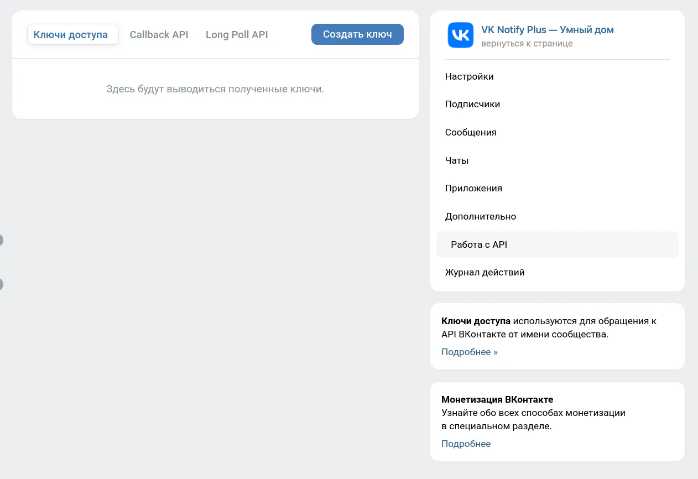
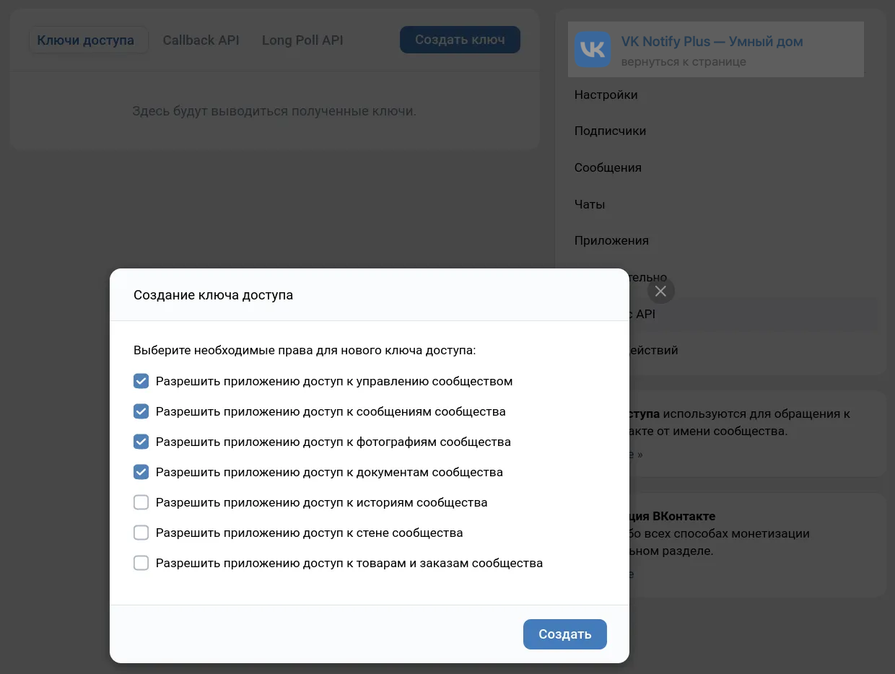
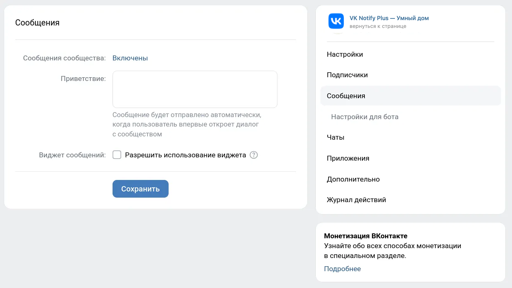
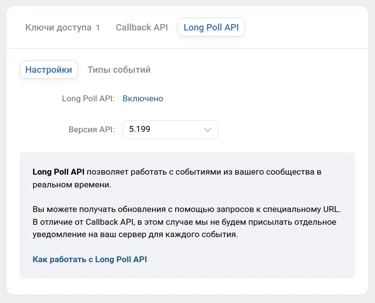
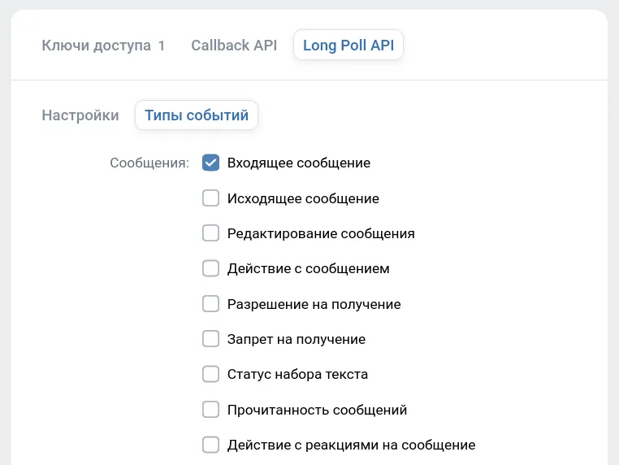
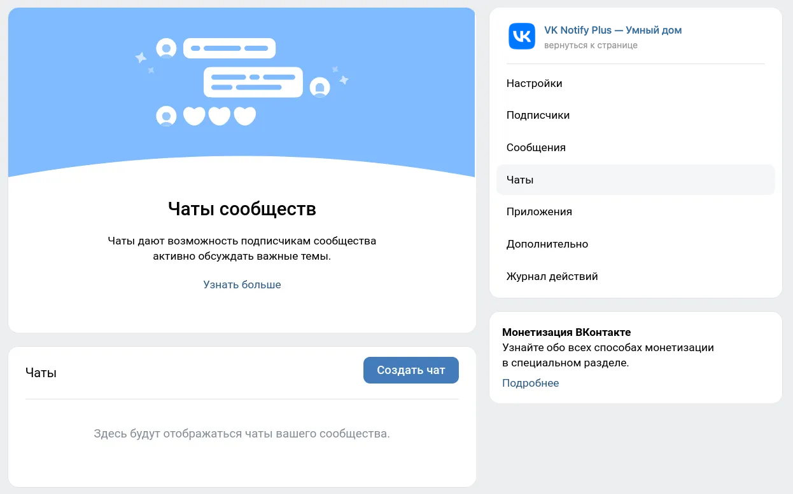
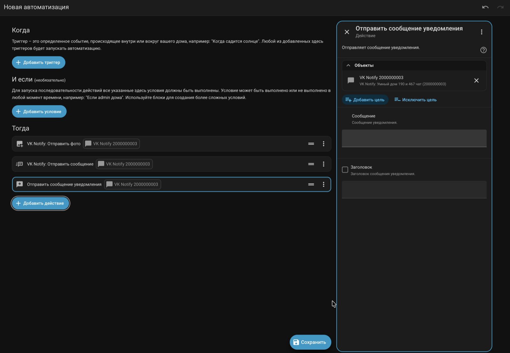
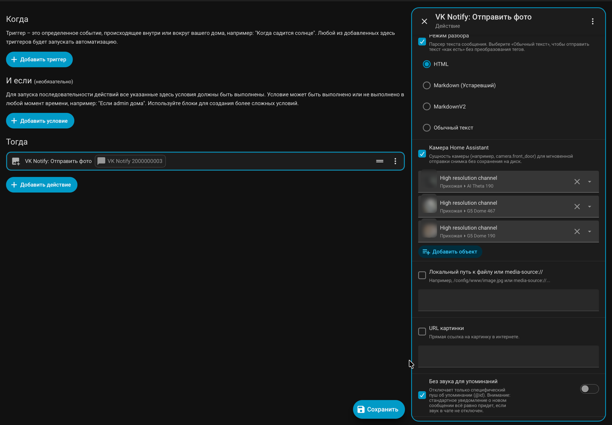
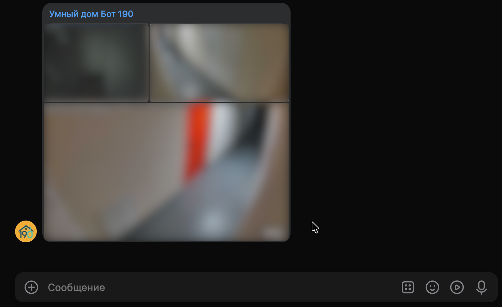

# 📖 Полное руководство по настройке сообщества ВКонтакте и интеграции VK Notify

В этом руководстве пошагово показано, как создать закрытое сообщество-бота во ВКонтакте, выпустить ключ доступа API, настроить **Bots Long Poll API** для двусторонней связи и подключить интеграцию **VK Notify** в Home Assistant.

---

## 1. Создание сообщества и получение ключа доступа VK API

1. Создайте новое сообщество во ВКонтакте (рекомендуется выбрать закрытый тип группы, чтобы посторонние не видели его содержимое).
2. Откройте страницу сообщества и перейдите в правом меню в раздел **Управление** → **Дополнительно** → **Работа с API**.
3. На вкладке **Ключи доступа** нажмите кнопку **Создать ключ**:

  

4. В появившемся окне отметьте разрешения для вашего бота и нажмите **Создать**:
   - ✅ **Разрешить приложению доступ к управлению сообществом** — обязательно для автоматического определения `group_id` и работы режима **Long Poll** (приём входящих команд и нажатий на кнопки);
   - ✅ **Разрешить приложению доступ к сообщениям сообщества** — обязательно для отправки и редактирования сообщений;
   - ✅ **Разрешить приложению доступ к фотографиям сообщества** — для отправки снимков камер и изображений (`vk_notify.send_photo`);
   - ✅ **Разрешить приложению доступ к документам сообщества** — для отправки файлов и голосовых сообщений (`vk_notify.send_file`, `vk_notify.send_voice`).

  

5. Подтвердите создание ключа и скопируйте полученный токен (он понадобится при добавлении интеграции в Home Assistant).

---

## 2. Включение сообщений сообщества и возможностей ботов

1. В меню управления сообществом перейдите в раздел **Сообщения**.
2. Переключите параметр **Сообщения сообщества** в положение **Включены** и нажмите **Сохранить**:

  

3. В подразделе **Сообщения → Настройки для бота** включите пункт **Возможности ботов: Включены** (это позволит прикреплять к сообщениям интерактивные инлайн-кнопки и клавиатуры).
4. Вернитесь на главную страницу вашего сообщества, нажмите кнопку **Сообщение** и **отправьте боту любое первое сообщение** (например, `Привет`).

> ⚠️ **Важно:** По правилам безопасности ВКонтакте бот сообщества не имеет права писать пользователю первым. Пока получатель хотя бы один раз не напишет сообществу, диалог не появится в списке доступных чатов.

---

## 3. Настройка Long Poll API (для приёма входящих сообщений, голосовых и кнопок)

> 💡 Если вам нужна **только односторонняя отправка** уведомлений из Home Assistant в ВК, этот шаг можно пропустить и выбрать при настройке режим **API**.

1. Перейдите в **Управление** → **Дополнительно** → **Работа с API** → вкладка **Long Poll API**.
2. Включите **Long Poll API: Включено** и установите **Версию API: `5.199`**:

  

3. Перейдите на соседнюю вкладку **Типы событий** и отметьте нужные события в блоке **Сообщения**:
   - ✅ **Входящее сообщение** — обязательно (для событий `vk_notify_text`, `vk_notify_command` и получения расшифровки голосовых `transcript`);
   - ✅ **Действие с сообщением** — обязательно для работы интерактивных `callback`-кнопок (событие `vk_notify_callback`);
   - ✅ **Статус набора текста** и **Прочитанность сообщений** — опционально (для событий `vk_notify_typing` и `vk_notify_read`).

  

---

## 4. Создание групповых бесед (чатов) сообщества

Если вы хотите отправлять уведомления сразу для нескольких членов семьи или разделить уведомления по тематическим чатам (например, «Охрана и камеры», «Климат», «Система»):

1. В меню **Управление сообществом** выберите раздел **Чаты** и нажмите **Создать чат**:

  

2. Задайте название беседы, отправьте в неё хотя бы одно сообщение и пригласите нужных участников по ссылке.
3. В Home Assistant вы можете добавить сколько угодно экземпляров интеграции **VK Notify** с одним и тем же токеном, выбрав для каждого свой чат (фоновый клиент Long Poll при этом запускается в единственном экземпляре на всё сообщество и не дублирует нагрузку).

---

## 5. Подключение и проверка в Home Assistant

1. Перейдите в **Настройки → Устройства и службы → Добавить интеграцию** и выберите **VK Notify**.
2. Вставьте **Токен доступа сообщества**, задайте имя (по умолчанию `VK Notify`) и при желании укажите **Токен пользователя для видео** ([инструкция](VIDEO_TOKEN_GUIDE.md)).
3. Выберите режим подключения (**API** или **Long Poll**) и отметьте **один или сразу несколько чатов** из автоматически загруженного списка диалогов сообщества.
4. Чтобы позже добавить новые чаты этого же сообщества (без повторного ввода токена), просто нажмите кнопку **«Добавить чат»** прямо на карточке сообщества в **Настройки → Устройства и службы → VK Notify**.
5. Для проверки перейдите в **Панель разработчика → Действия (Services)**:
   - вызовите **`vk_notify.send_message`** (*«VK Notify: Отправить сообщение»*) или **`vk_notify.send_photo`** (выбрав одну или несколько камер в поле **Камера Home Assistant**, либо указав `url` / `file`);
   - обратите внимание: в списке действий Home Assistant также есть системная служба **«Отправить сообщение уведомления» (`notify.send_message`)** — в ней по стандарту ядра HA есть только поля `Сообщение` и `Заголовок` (она нужна для совместимости с универсальными сторонними Blueprint'ами). Для доступа ко всем функциям ВКонтакте (кнопки, карусели, геолокация, цитаты `reply_to` и возврат `conversation_message_id`) всегда выбирайте **«VK Notify: Отправить сообщение» (`vk_notify.send_message`)**;
   - для проверки входящих команд откройте вкладку **События**, подпишитесь на `vk_notify_text` или `vk_notify_command` и отправьте сообщение боту во ВКонтакте.

  

  

  

---

⬅️ **[Вернуться к основной документации (../README.md)](../README.md)** | 🤖 **[Примеры автоматизаций (AUTOMATIONS.md)](AUTOMATIONS.md)**
